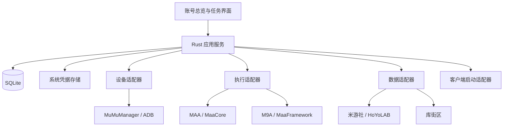

# 架构草案

Windows 原型已实现账号卡片、米游社查询入口、抽卡文件导入和按需 MuMu 查询。本文还包含后续任务执行和数据持久化设计。

## 技术栈

- Windows 桌面端：Tauri 2。
- 界面：React + TypeScript。
- 本地服务：Rust，管理进程、设备、数据同步和调度。
- 持久化：SQLite；Cookie / Token 通过 Windows 安全存储访问。
- 现有工具：优先通过独立进程接入；底层运行器按版本验证后再选择。

首版使用 Windows 本机的 MSVC 工具链编译和验证。账号和抽卡记录保存在本地 JSON 文件中，米游社凭据通过 Windows DPAPI 加密。SQLite 和其他平台构建留作后续设计。

## 模块关系

## 核心实体

| 实体 | 关键内容 |
| --- | --- |
| Installation | 程序路径、类型、可执行文件版本、项目资源版本、能力探测结果 |
| Device | 安装 ID、MuMu 实例索引、当前状态；ADB 地址作为运行时发现结果 |
| CommunityAccount | 平台账号及系统凭据引用，不在数据库保存 Token |
| GameRole | 游戏、区服、UID、备注，关联社区账号和执行环境 |
| TaskPreset | 工具配置引用、目标设备、计划；原工具配置只在明确导入后转换 |
| Run | 本次执行的配置快照、状态、时间、进度、结果和日志索引 |
| DataSnapshot | 角色、数据来源、字段值、查询时间、上游时间、质量和错误类型 |

一个社区账号可关联多个游戏角色。一个 MuMu 安装可有多个实例，同一实例可以有多个游戏。通过关联表达关系，不用目录名或端口作为永久身份。

## 三类适配器与启动器

DeviceAdapter：发现实例、查询状态，后续增加启动、停止和等待 Android 就绪。

RunnerAdapter：报告自身能力、准备运行、启动、请求停止，并提供结构化事件。MaaCore 与 MaaFramework 分开实现；不支持的能力明确返回不支持。

DataProvider：发现绑定角色、查询快照、识别认证状态和上游限制。不负责执行游戏任务。

LauncherAdapter：定位客户端和启动入口，区分统一启动器、游戏本体、旧安装和渠道。客户端自动切号作为独立能力验证。

## 执行与资源占用

- 同一设备一次一个执行任务；不同模拟器可分别运行。
- 若未来接入 PC 游戏自动化，按前台窗口和输入资源加锁。
- 程序退出码、任务事件和完成目标分别记录。没有完成证据的执行结果为 `unknown`。
- 运行状态：`queued → preparing → running → succeeded / failed / needs_attention / cancelled / unknown`。
- 停止和超时分别处理；恢复程序后先检查原进程及运行记录，避免重复执行。
- 重试有次数限制，只对已确认可重试的步骤生效，认证失败和人工验证不会无限重试。

## 体力与日常数据

数据质量可为 `fresh`、`stale`、`estimated` 或 `unavailable`。错误类型至少区分 `auth_required`、`rate_limited`、`verification_required`、`network_error` 和 `unsupported`。旧快照与最近同步错误分别存储。

预计回满时间优先使用上游字段；时间推算要有来源和时间基准。字段上限从数据源读取，不把某个版本的数值写死。

## 桌面权限

远程社区网页与本地管理界面隔离，本地敏感命令通过 Rust 校验参数；不向网页开放任意 shell。MuMu 查询工作目录和运行环境需显式设置并报告诊断结果。

首版调度依赖托盘常驻；用户完全退出后停止调度。后续如需无人登录运行，再单独设计 Windows 计划任务支持。
